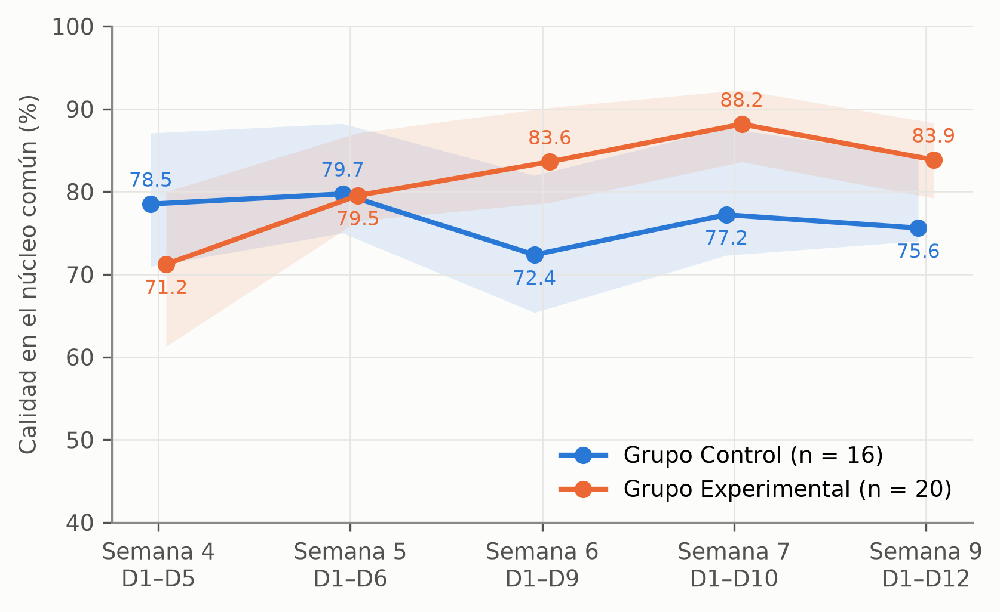
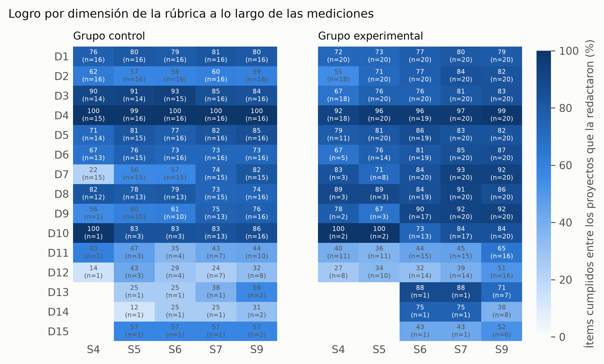
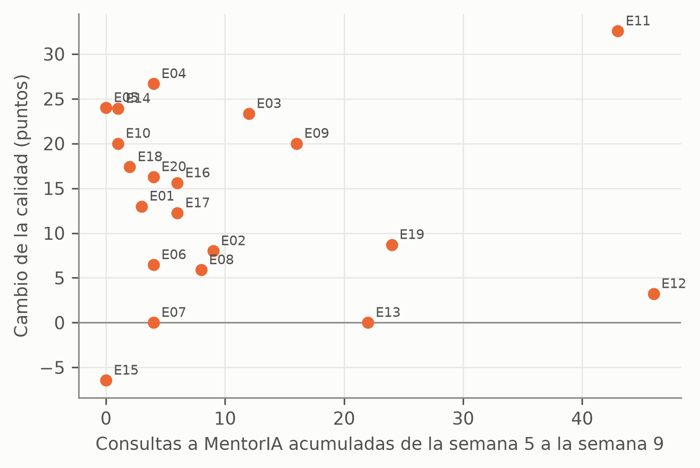

# Efecto de un sistema multiagente de mentoría metodológica en la calidad de proyectos de tesis de ingeniería: un cuasiexperimento longitudinal en la UPAO, 2026-2

**Effect of a multi-agent methodological mentoring system on the quality of engineering thesis projects: a longitudinal quasi-experiment at UPAO, 2026-2**

Clever Josué Aguilar Idrogo¹, Alessia Vidamilagros Aguilar Alayo¹, Walter Manuel Cueva Chávez¹

¹ Programa de Estudio de Ingeniería de Computación y Sistemas, Facultad de Ingeniería, Universidad Privada Antenor Orrego, Trujillo, Perú.

Autor de correspondencia: Clever Josué Aguilar Idrogo, cleverjosue1@gmail.com

ORCID del asesor: https://orcid.org/0000-0001-9660-6354

<!-- [AUTOR] Confirmar orden de autoría, ORCID de los tesistas y correo institucional de correspondencia. -->

---

## Resumen

**Objetivo.** Determinar el efecto del uso de un sistema multiagente de mentoría metodológica (MentorIA) en la calidad metodológica de los proyectos de tesis de estudiantes de Ingeniería de la Universidad Privada Antenor Orrego (UPAO) durante el semestre 2026-2. **Método.** Estudio de enfoque mixto con diseño cuasiexperimental longitudinal con grupo de control no equivalente. Participaron dos secciones intactas del curso Proyecto de Investigación a cargo del mismo docente, con el proyecto de tesis como unidad de análisis (20 proyectos por sección; muestra analítica de 16 proyectos en el Grupo Control y 20 en el Grupo Experimental). El diagnóstico del proceso de mentoría tradicional se obtuvo de entrevistas semiestructuradas a seis asesores procesadas con análisis temático. La calidad metodológica se midió en las semanas 4, 5, 6, 7 y 9 con una rúbrica dicotómica de 100 ítems en 15 dimensiones, validada por siete expertos (V de Aiken entre .81 y 1.00) y aplicada por un panel de tres jueces basados en modelos de lenguaje con voto de mayoría y evaluación ciega. La calidad argumentativa de la descripción del problema y de la justificación se evaluó computacionalmente con el modelo de Toulmin. **Resultados.** Los grupos no difirieron en la medición inicial en la calidad del núcleo común de dimensiones (71.2 % frente a 78.5 %; p = .057), pero sí en la trazabilidad, a favor del Grupo Control (p = .012). Entre la semana 4 y la semana 9 la calidad aumentó en 32 de 36 proyectos (mediana +13.0 puntos; p < .001). La pendiente semanal del Grupo Experimental fue 3.10 puntos mayor que la del Grupo Control (p < .001) y el efecto del sistema sobre el cambio de la calidad fue grande (d de Cohen = +1.32; IC 95 % [+0.60; +2.05]; p < .001), concentrado en la descripción del problema y en las dimensiones redactadas durante la intervención. El uso acumulado del sistema (215 consultas) no se relacionó con la mejora (ρ = −.14; p = .725). El índice argumentativo de la justificación aumentó más en el Grupo Experimental (p ajustado = .027), no así el de la descripción del problema. **Conclusión.** Disponer del sistema multiagente, como complemento de la asesoría tradicional, se asoció con una evolución significativamente más favorable de la calidad metodológica de los proyectos, sin evidencia de una relación de dosis y respuesta.

**Palabras clave:** sistemas multiagente; modelos de lenguaje; calidad metodológica; proyectos de tesis; mentoría académica; educación superior.

## Abstract

**Objective.** To determine the effect of a multi-agent methodological mentoring system (MentorIA) on the methodological quality of thesis projects written by engineering students at Universidad Privada Antenor Orrego (UPAO) during the 2026-2 semester. **Method.** Mixed-methods study with a longitudinal quasi-experimental nonequivalent control group design. Two intact sections of the Research Project course taught by the same instructor took part, with the thesis project as the unit of analysis (20 projects per section; analytic sample of 16 control and 20 experimental projects). The traditional mentoring process was diagnosed through semi-structured interviews with six advisors analyzed thematically. Methodological quality was measured in weeks 4, 5, 6, 7 and 9 with a 100-item dichotomous rubric in 15 dimensions, validated by seven experts (Aiken's V between .81 and 1.00) and applied by a panel of three language-model judges with majority voting and blind evaluation. The argumentative quality of the problem description and the justification was assessed computationally with Toulmin's model. **Results.** Groups did not differ at baseline in the quality of the common core of dimensions (71.2% vs. 78.5%; p = .057) but did differ in traceability, favoring the control group (p = .012). Between weeks 4 and 9, quality increased in 32 of 36 projects (median +13.0 points; p < .001). The weekly slope of the experimental group was 3.10 points higher than that of the control group (p < .001), and the effect of the system on the change in quality was large (Cohen's d = +1.32; 95% CI [+0.60; +2.05]; p < .001), concentrated in the problem description and in the dimensions written during the intervention. Cumulative use of the system (215 queries) was unrelated to improvement (ρ = −.14; p = .725). The argumentation index of the justification increased more in the experimental group (adjusted p = .027), but not that of the problem description. **Conclusion.** Having the multi-agent system available as a complement to traditional advising was associated with a significantly more favorable evolution of the methodological quality of the projects, with no evidence of a dose-response relationship.

**Keywords:** multi-agent systems; large language models; methodological quality; thesis projects; academic mentoring; higher education.

---

## 1. Introducción

En la Facultad de Ingeniería de la Universidad Privada Antenor Orrego (UPAO), el curso Proyecto de Investigación es la etapa en la que los estudiantes del Programa de Ingeniería de Computación y Sistemas formulan el proyecto de tesis con el que optarán al título profesional, bajo un modelo de asesoría individualizada. Ese modelo presenta una limitación estructural: la asesoría se organiza en sesiones programadas dentro de un horario fijo y no ofrece un canal de orientación metodológica en el momento en que surge la duda, de modo que los vacíos no resueltos se acumulan y se propagan a lo largo del documento. A ello se suma una condición propia de la formación en ingeniería: los estudiantes tienden a concebir el proyecto desde la solución tecnológica que desean construir y no desde el problema científico que pretenden resolver, lo que invierte el orden metodológico y produce errores recurrentes en la formulación del problema, la definición de variables y el diseño. Según los asesores de la facultad, más de la mitad de los proyectos presentados en primera instancia son devueltos con observaciones de fondo metodológico. El problema no es exclusivo de una institución: en una universidad pública peruana, el 80 % de las tesis de pregrado aprobadas presentó una calidad metodológica regular, con deficiencias atribuidas en parte a la orientación recibida (Estrada Araoz et al., 2022), y los estudios sobre las dificultades del tesista peruano se han construido desde el documento terminado o desde la voz del estudiante, sin incluir la perspectiva de quien asesora (Perdomo y Morales, 2022; Vilca Colquehuanca et al., 2023). La supervisión de tesis de pregrado, además, ha recibido mucha menos atención investigativa que la doctoral (Agricola et al., 2021).

Los agentes conversacionales pedagógicos se han propuesto como mecanismo de acompañamiento continuo, personalizado y escalable en la educación superior, con aplicaciones que incluyen la mentoría (Yusuf et al., 2025). La evidencia sobre su efecto en la escritura de investigación, sin embargo, es heterogénea y depende de la arquitectura de la herramienta. Un agente conversacional sin arquitectura especializada tendió a operar como un dispensador de recursos y no sostuvo interacciones de profundidad cognitiva en la tutoría de proyectos de investigación (Ortega-Ochoa, 2021); un chatbot básico tuvo una adopción limitada y fallos frecuentes ante consultas de contenido complejo en un curso de investigación académica en Lima (Arredondo Castillo, 2020); y el uso espontáneo de ChatGPT no produjo diferencias significativas en la calidad de textos académicos frente a un grupo de control no equivalente (Apolín Montes et al., 2024). En cambio, una intervención estructurada en cuatro sesiones con ChatGPT elevó del 2.8 % al 80.6 % la proporción de estudiantes de posgrado con un nivel adecuado en la formulación de proyectos de investigación, aunque con un diseño preexperimental sin grupo de comparación (Hinojosa Mamani et al., 2024). Una revisión sistemática con metaanálisis recomienda evaluar estos efectos a lo largo del tiempo para distinguirlos de un efecto de novedad (Deng et al., 2025).

Los sistemas multiagente basados en modelos de lenguaje ofrecen una alternativa a la asistencia conversacional de un único modelo. El debate entre varios agentes que proponen y critican respuestas mejoró la exactitud factual y el razonamiento de los modelos de lenguaje (Y. Du et al., 2024); en un cuasiexperimento con estudiantes de computación, la condición con debate multiagente obtuvo una mejora relativa del aprendizaje del 29.78 %, con un tamaño de efecto medio (J. Du et al., 2025); la separación de roles entre agentes críticos y un juez redujo la sicofancia pedagógica de los tutores automatizados (Sadhu y Dhor, 2025); y la descomposición de la evaluación de ensayos en agentes especializados guiados por una rúbrica elevó el acuerdo con calificadores humanos (Jordán et al., 2025). Los paneles de jueces basados en modelos de lenguaje, no obstante, presentan un sesgo de autopreferencia cuando el evaluador y el generador pertenecen a la misma familia de modelos (Panickssery et al., 2024). Por otro lado, la estructura argumentativa de los textos de estudiantes puede identificarse de forma automática y reproducible (Stab y Gurevych, 2017), y la retroalimentación sobre esa estructura mejoró la calidad de los textos persuasivos (Wambsganss et al., 2020); esos procedimientos, sin embargo, se han desarrollado sobre ensayos y no sobre las secciones argumentativas de un proyecto de investigación.

De la revisión se desprenden cinco brechas. Primera, la escasez de diagnósticos de las deficiencias metodológicas desde la perspectiva del asesor de ingeniería y organizados por sección del proyecto. Segunda, la medición de la calidad metodológica en un único momento o con solo dos mediciones, que no permite describir cuándo se separan las trayectorias de los grupos. Tercera, el predominio de intervenciones con un modelo conversacional único y de propósito general, con escasa evidencia controlada sobre sistemas multiagente especializados. Cuarta, el registro del uso real de las herramientas con fines descriptivos, sin vincularlo con la calidad de un producto de investigación. Quinta, la ausencia de una evaluación computacional de la argumentación en proyectos de investigación y de su relación con la calidad metodológica del documento.

El objetivo general del estudio fue determinar el efecto del uso de un sistema multiagente de mentoría metodológica en la calidad metodológica de los proyectos de tesis de los estudiantes de Ingeniería de la UPAO en el semestre 2026-2. Los objetivos específicos fueron: (OE1) explorar las deficiencias metodológicas recurrentes del proceso de mentoría tradicional desde la perspectiva de los asesores; (OE2) medir la evolución de la calidad metodológica de los proyectos a lo largo de mediciones semanales; (OE3) determinar la relación entre el nivel de uso del sistema y la mejora de la calidad en el Grupo Experimental; (OE4) comparar la evolución de la calidad entre el Grupo Control y el Grupo Experimental; y (OE5) comparar entre grupos la evolución de la calidad argumentativa de la descripción del problema y de la justificación, evaluada computacionalmente según el modelo de Toulmin. La hipótesis general planteó que el sistema multiagente tiene un efecto positivo y estadísticamente significativo en la calidad metodológica de los proyectos; las hipótesis específicas 2 a 5 plantearon, respectivamente, que la calidad aumenta a lo largo de las mediciones, que el nivel de uso se relaciona positivamente con la mejora, que el Grupo Experimental presenta una evolución mayor que el Grupo Control y que la calidad argumentativa aumenta más en el Grupo Experimental.

## 2. Materiales y métodos

### 2.1. Diseño

Se adoptó un enfoque mixto, de tipo aplicado y alcance explicativo, con un diseño cuasiexperimental longitudinal con grupo de control no equivalente (Hernández Sampieri y Mendoza Torres, 2018). Los grupos fueron dos secciones intactas del curso; cada sección se asignó al azar, en bloque, a una de las dos condiciones. La variable independiente, la exposición al sistema multiagente, se manipuló al ponerlo a disposición únicamente del Grupo Experimental; la variable dependiente, la calidad metodológica del proyecto de tesis, se midió semanalmente en ambos grupos con el mismo instrumento y el mismo sistema evaluador. El esquema del diseño fue GC: O1 → O2 → … → On; GE: O1 → X → O2 → X → … → On, donde O1 es la medición inicial de la semana 4, X es el uso del sistema entre mediciones consecutivas y O2 a On son las mediciones sucesivas. Como ambos grupos inician el curso con una plantilla institucional sin texto evaluable, la equivalencia se verificó en la medición inicial, cuando ya habían redactado las primeras dimensiones del proyecto. La validez interna se abordó con tres estrategias: la verificación de la homogeneidad inicial sobre el núcleo común de dimensiones desarrolladas por ambos grupos; la comparación de las trayectorias de ambos grupos sobre las mismas dimensiones; y el análisis de dosis y respuesta dentro del Grupo Experimental, que mantiene constantes los factores propios de la sección.

### 2.2. Población y muestra

La unidad de análisis fue el proyecto de tesis, no el estudiante, dado que la variable dependiente se mide sobre el documento y cada proyecto puede ser elaborado por uno o dos estudiantes. La población estuvo constituida por los proyectos del curso Proyecto de Investigación de la Facultad de Ingeniería de la UPAO en el semestre 2026-2, dictado en tres secciones con 31, 30 y 33 estudiantes matriculados. La muestra, no probabilística e intencional, comprendió las dos secciones a cargo del mismo docente, con el mismo sílabo y calendario de entregas, lo que evita confundir el efecto del docente con el de la intervención; cada sección conformó 20 proyectos y dentro de cada una se incluyeron todos los proyectos cuyos estudiantes autorizaron su participación. Se incluyeron en el análisis los proyectos que presentaron una versión evaluable, con texto propio en al menos una dimensión de la rúbrica, en la medición inicial. Cuatro proyectos del Grupo Control conservaban únicamente el formato del curso en esa medición y no forman parte de la muestra analítica, que quedó conformada por 36 proyectos: 16 del Grupo Control y 20 del Grupo Experimental. Para el quinto objetivo específico, la unidad de análisis fue la sección argumentativa completa de cada proyecto (descripción del problema y justificación), definida como la que contiene al menos 80 palabras propias con al menos el 60 % de ellas en oraciones completas.

### 2.3. Intervención: el sistema multiagente MentorIA

El Grupo Experimental dispuso, además de la asesoría tradicional, del sistema multiagente de mentoría metodológica MentorIA, una aplicación web desplegada en la nube a la que cada estudiante accedió con una cuenta individual. El sistema recibe el proyecto del estudiante en formato PDF, Word o texto, lo indexa en un almacén vectorial de sesión y lo evalúa contra una rúbrica estructurada por criterios metodológicos explícitos; el estudiante declara qué partes desea revisar, de modo que lo no entregado no se califica. El núcleo es una red de agentes basados en modelos de lenguaje con roles separados, orquestada por un supervisor que decide en cada turno qué agente interviene: un Auditor que califica los criterios de la rúbrica con salida estructurada, un Metodólogo que revisa el rigor y la coherencia cruzada entre secciones (problema, objetivos, hipótesis, variables y diseño), un Redactor que propone texto mejorado apoyado en recuperación aumentada de bibliografía metodológica y una ronda de debate entre el Redactor y los evaluadores, con protección contra bucles. El documento original del estudiante nunca se modifica: las mejoras se presentan como propuestas que el estudiante decide incorporar. Las interacciones disponibles fueron de cuatro tipos: consultas rápidas, mejoras rápidas de un fragmento, revisiones de una sección y revisiones completas del proyecto. Conforme a la escala de madurez tecnológica adaptada por el Consejo Nacional de Ciencia, Tecnología e Innovación Tecnológica (CONCYTEC, 2022), el sistema se ubica en el nivel TRL 7, al estar desplegado y en uso real durante el curso. Su arquitectura, configuración y base de conocimiento permanecieron fijas durante el estudio. El sistema estuvo disponible en modalidad de prueba desde la semana 2; la intervención se computa a partir de la medición inicial, de la semana 5 a la semana 9.

<!-- [AUTOR] La tesis v14 no describe la arquitectura de MentorIA; este párrafo se redactó a partir del repositorio del sistema. Confirmar los nombres de los agentes y el proveedor de modelos: la tesis indica que gpt-4o-mini es uno de los modelos que MentorIA emplea; el README del repositorio menciona llama-3.3-70b vía Groq. Dejar un solo dato coherente en ambos documentos. -->

### 2.4. Instrumentos y medidas

**Rúbrica de calidad metodológica.** La calidad metodológica se midió con una rúbrica de 100 ítems dicotómicos (Cumple = 1; No cumple = 0) agrupados en 15 dimensiones, construida para el estudio a partir de los criterios de Hernández Sampieri y Mendoza Torres (2018) y de la definición de calidad metodológica como grado de cumplimiento de los estándares de rigor que sustentan la validez (Chacón-Moscoso et al., 2023). Las dimensiones son: título; descripción y delimitación del problema; formulación del problema; objetivos; justificación, importancia y viabilidad; limitaciones; marco teórico; hipótesis; variables y operacionalización; matriz de consistencia; tipo, enfoque y alcance; diseño; población, muestra y muestreo; técnicas e instrumentos; y técnicas de procesamiento y análisis. Un ítem se califica como cumplido solo cuando el elemento está declarado explícitamente en el texto. La validez de contenido se estableció por juicio de siete expertos con grado de magíster o doctor y entre 4 y 15 años de experiencia en investigación o asesoría de tesis, en dos rondas, siguiendo la planilla de Escobar-Pérez y Cuervo-Martínez (2008), con el coeficiente V de Aiken (Aiken, 1980) y un criterio de aceptación de V ≥ .80 por ítem para pertinencia, relevancia y claridad, y por dimensión para suficiencia. En la primera ronda los coeficientes oscilaron entre .67 y 1.00 (media .96) y doce ítems no alcanzaron el criterio; se reformularon 27 ítems sin alterar el número de ítems ni de dimensiones. En la segunda ronda todos los ítems alcanzaron el criterio, con valores entre .81 y 1.00 (media .98) y 55 ítems con V = 1.00 en los tres criterios; la suficiencia por dimensión osciló entre .81 y 1.00. La variable principal fue la *calidad de lo redactado*: el porcentaje de criterios cumplidos sobre los criterios de las dimensiones que el proyecto ha desarrollado, lo que separa la calidad de lo escrito de la extensión del avance; cuando el proyecto desarrolla las 15 dimensiones coincide con el puntaje total de 0 a 100. Se derivaron además la calidad en el núcleo común de dimensiones desarrolladas por ambos grupos y la trazabilidad entre título, problema y objetivos, calculada como el porcentaje cumplido de seis ítems de correspondencia.

**Sistema evaluador multiagente.** La rúbrica fue administrada en todas las mediciones por un sistema evaluador construido para el estudio, lo que hizo viable la evaluación semanal de los 40 proyectos y evitó el conflicto de interés de que el asesor calificara a sus propios asesorados. El sistema está compuesto por un panel de tres jueces basados en modelos de lenguaje de distinta capacidad (gpt-4o-mini, gpt-4.1-mini y gpt-4.1), orquestados en una arquitectura de red mediante LangGraph. Cada juez evalúa de manera independiente los ítems de las dimensiones con texto propio del estudiante, restringiendo su juicio a los criterios explícitos del instrumento y a la evidencia textual del documento; el puntaje de cada ítem se obtiene por voto de mayoría. Los tres jueces operan con temperatura 0 y semilla fija. La evaluación es ciega: antes de enviar el texto, el sistema enmascara nombres, documentos de identidad, correos, ORCID y teléfonos, y ningún juez recibe el nombre del archivo ni el grupo del proyecto. Los ítems de las dimensiones sin texto propio, incluidas las que conservan solo el texto de la plantilla institucional, se registran como no cumplidos sin consultar al panel. Cuando una entrega presenta el mismo texto que la anterior, el proyecto conserva su calificación. Como evidencia de consistencia se reportan, en cada medición, el porcentaje de decisiones unánimes, el kappa de Fleiss (Fleiss, 1971) y el coeficiente AC1 de Gwet (Gwet, 2008). Conforme al CONCYTEC (2022), el sistema evaluador se ubica en el nivel TRL 6, como prototipo funcional operado por los investigadores.

**Índice argumentativo y coherencia global.** El sistema evaluador calcula dos indicadores de coherencia en los que el modelo de lenguaje no asigna la nota: identifica elementos del texto, el sistema los verifica automáticamente y la nota se obtiene con una regla fija. El índice argumentativo se basa en los seis componentes del modelo de Toulmin (2003): afirmación, dato, garantía, respaldo, calificador y refutación, cuya presencia distingue un argumento elaborado de una enumeración de afirmaciones y datos (Erduran et al., 2004; Qin y Karabacak, 2010). En su versión 2.0, empleada para el quinto objetivo, la sección completa se divide en párrafos y unidades numeradas y el modelo gpt-4.1 (temperatura 0, semilla fija) identifica las afirmaciones del autor y las unidades de cualquier párrafo que actúan como su dato, garantía, respaldo o refutación; el sistema verifica que los identificadores existan y que cada garantía conecte un dato válido de la misma afirmación. Se calculan el *índice estructural* (tipos de componente presentes sobre seis, en porcentaje), el *índice de elaboración* (media, sobre las afirmaciones, de la proporción de los cinco componentes de apoyo que tiene cada una), el nivel argumentativo de 0 a 5 adaptado de Erduran et al. (2004) y el perfil de componentes. Su estabilidad test-retest, verificada en 58 secciones de la semana 4, fue del 80.6 % en las funciones asignadas a 1 215 unidades y del 65.4 % en los vínculos, con un coeficiente de correlación intraclase CCI(2,1) de .77 en ambos índices, interpretado según Koo y Li (2016). La coherencia global del proyecto se obtiene de las contradicciones entre dos partes del documento que el modelo lista con cita literal y que el sistema conserva solo si ambas citas existen en el texto; la nota de 1 a 5 se asigna por regla según el número y la gravedad de las contradicciones.

**Registro de uso del sistema.** La aplicación efectiva de la intervención se verificó con los registros automáticos del sistema, organizados por proyecto y semana académica: número de consultas por tipo (indicador principal de dosis), días con consultas, minutos en sesiones con consultas y sesiones sin mensajes. Una sesión es un bloque de actividad sin pausas mayores de 30 minutos; los minutos de las sesiones sin mensajes se reportan solo como exposición y se incorporan en un análisis de sensibilidad. Una semana sin consultas se registra con dosis cero. Las cuentas se asignaron a los proyectos a partir de los autores de la carátula y se verificaron con los documentos subidos.

**Entrevista semiestructurada.** Para el primer objetivo se aplicó una guía de entrevista, revisada por juicio de expertos, a seis asesores y revisores de proyectos de tesis de la Facultad de Ingeniería, orientada a identificar deficiencias metodológicas, limitaciones de la mentoría tradicional y funcionalidades esperadas de una herramienta de apoyo. Las transcripciones se procesaron mediante identificación de unidades de significado, codificación, agrupación en categorías y triangulación (Vives Varela y Hamui Sutton, 2021); el criterio de rigor fue la saturación de categorías y la convergencia entre informantes.

### 2.5. Procedimiento

El curso inició en la semana 1 con la plantilla institucional del proyecto sin contenido. Cada grupo presentó su avance en su sesión semanal de clase, los lunes el Grupo Experimental y los jueves el Grupo Control, de modo que ambos fueron medidos con el mismo número de sesiones. Las mediciones se realizaron en las semanas 4 (medición inicial), 5, 6, 7 y 9 del semestre; en la semana 8 no hubo medición porque los proyectos no presentaron avances. En cada medición, el sistema evaluador segmentó la entrega en las dimensiones de la rúbrica con reglas fijas, verificó la segmentación contra el documento original, calificó las dimensiones con texto propio y calculó el índice argumentativo y la coherencia global. El uso del sistema de cada semana se relacionó con el cambio de la calidad en el intervalo que termina en esa semana. El procesamiento estadístico y las figuras se realizaron en Python con las bibliotecas pandas y Seaborn.

### 2.6. Análisis de datos

La información cualitativa se procesó mediante análisis temático. Para los datos cuantitativos se reportaron la media, la mediana y la desviación estándar de la calidad de lo redactado por grupo y medición, y el porcentaje de logro por dimensión. La homogeneidad inicial se verificó con una regla de decisión fijada de antemano: normalidad por grupo con la prueba de Shapiro-Wilk (Shapiro y Wilk, 1965) y homogeneidad de varianzas con la prueba de Levene centrada en la mediana (Brown y Forsythe, 1974); según su resultado, prueba t de Student, t de Welch o U de Mann-Whitney, con un nivel de significancia de .05 y el tamaño del efecto con la g de Hedges (Hedges, 1981) o el delta de Cliff (Cliff, 1993), interpretados según Cohen (1988) y Romano et al. (2006). La hipótesis específica 2 se contrastó con la prueba de rangos con signo de Wilcoxon, unilateral, sobre el cambio de la calidad de cada proyecto entre la semana 4 y la semana 9, calculado sobre las dimensiones redactadas en ambas mediciones. La hipótesis específica 3 se contrastó con la correlación de Spearman, unilateral, entre el uso acumulado (consultas) y el cambio total de la calidad en el Grupo Experimental; como complemento se reportaron las correlaciones por intervalo y un modelo de efectos mixtos con el uso de la semana y el de la semana anterior. La hipótesis específica 4 se contrastó con un modelo lineal de efectos mixtos con intercepto aleatorio por proyecto, calidad ~ grupo × semana, sobre la calidad en las dimensiones desarrolladas por al menos la mitad de los proyectos de cada grupo en cada medición; se rechaza H0 si la interacción favorece al Grupo Experimental con p unilateral < .05, y se complementó con la prueba U de Mann-Whitney sobre el cambio total. La hipótesis específica 5 se contrastó con la prueba U de Mann-Whitney, unilateral, sobre el cambio del índice de elaboración de cada sección entre la primera y la última medición con la sección completa, con la corrección de Holm (1979) para las dos secciones; se acepta de forma parcial si se rechaza H0 en una sola sección. La hipótesis general se contrastó de forma independiente con la d de Cohen (Cohen, 1988) de la diferencia entre grupos en el cambio de la calidad en el núcleo común entre la medición inicial y la final, con su intervalo de confianza del 95 % y una prueba unilateral elegida con la misma regla de normalidad; se acepta Hi si d favorece al Grupo Experimental, d ≥ 0.20 y p < .05. Cada hipótesis se decidió con una sola prueba principal.

### 2.7. Aspectos éticos

Los estudiantes de ambas secciones autorizaron su participación en el estudio. Los documentos se anonimizaron antes de su evaluación y los asesores entrevistados dieron su consentimiento para el registro y análisis de las entrevistas. El sistema de mentoría no modificó los documentos de los estudiantes y su uso fue voluntario y complementario a la asesoría del curso.

## 3. Resultados

### 3.1. Diagnóstico del proceso de mentoría tradicional

El análisis temático de las seis entrevistas identificó 151 unidades de significado, organizadas en 35 códigos (29 apriorísticos y 6 emergentes) y agrupadas en 8 categorías. Seis categorías alcanzaron saturación plena en los seis asesores: la percepción general del nivel metodológico, la coherencia y trazabilidad interna del proyecto, las dudas repetitivas de los estudiantes, la divergencia de criterios entre asesores y jurados, los criterios mínimos de rigor y la frecuencia de devolución de proyectos en la primera presentación, cuyas estimaciones oscilaron entre el 10 % y el 70 % según el informante. Las deficiencias se concentraron en el marco metodológico y en la formulación del problema, con incidencia alta, y en las variables e indicadores, con incidencia media alta; los errores de citación y formato fueron calificados como menores (Tabla 1). Los asesores dedican entre 5 y 8 horas mensuales a dudas repetitivas y entre 3 y 4 horas adicionales a consultas fuera de horario, y describieron la naturaleza puntual de la asesoría como la principal limitación estructural. Las funcionalidades que esperan de una herramienta de apoyo son la revisión de coherencia entre problema, objetivos, variables e hipótesis, la orientación metodológica, las sugerencias basadas en evidencia y la disponibilidad permanente, con dos condiciones de confianza: trazabilidad hacia fuentes verificables y un rol estrictamente de apoyo. Un código emergente situó parte de las deficiencias en la rigidez del propio modelo institucional de investigación.

**Tabla 1**

*Deficiencias metodológicas por sección del proyecto según los asesores*

| Sección del proyecto | Hallazgo principal | Incidencia |
|---|---|---|
| Formulación del problema | Problema poco delimitado y superficial; no refleja la realidad problemática completa | Alta |
| Marco metodológico | Predominio de esquemas pretest-postest; desconocimiento de alternativas; secuencias rígidas | Alta |
| Variables e indicadores | Variables mal definidas o no operacionalizadas; indicadores poco claros | Media-alta |
| Objetivos | Objetivos específicos mal dimensionados y no alineados con el general | Media |
| Hipótesis | Hipótesis vagas o basadas en conjeturas; sin alineación con el problema | Media |
| Título | Ambigüedad, redundancia y falta de trazabilidad con objetivos e hipótesis | Media |
| Marco teórico | Referencias incompletas; falta de análisis crítico de antecedentes | Media |
| Referencias y citación | Errores menores en normas APA, corregibles con herramientas | Baja |

*Nota.* Síntesis del análisis temático de seis entrevistas semiestructuradas a asesores de la Facultad de Ingeniería de la UPAO; 151 unidades de significado, 35 códigos y 8 categorías.

### 3.2. Condición inicial de los grupos

En la medición inicial, los 20 proyectos del Grupo Experimental y 16 de los 20 del Grupo Control presentaban texto propio evaluable. El Grupo Control había redactado en promedio más dimensiones (7.4 frente a 6.0) y tenía un puntaje total mayor (mediana de 33.5 frente a 22.0 puntos), mientras que la calidad de todo lo redactado era similar (64.8 % y 66.8 %), lo que muestra que el puntaje total refleja el avance y no la calidad. Por ello, la homogeneidad se verificó sobre el núcleo común de las dimensiones 1 a 5, desarrolladas por ambos grupos. La calidad del núcleo común fue normal en ambos grupos y con varianzas homogéneas; la trazabilidad, el índice argumentativo y la coherencia global no fueron normales (Shapiro-Wilk, p < .001). Los grupos no difirieron de forma significativa en la calidad del núcleo común, en el índice argumentativo de la descripción del problema ni en la coherencia global, pero sí en la trazabilidad, a favor del Grupo Control (Tabla 2), por lo que la homogeneidad inicial fue parcial. La descripción del problema fue la dimensión del núcleo con menor logro en ambos grupos (62 % en el Grupo Control y 55 % en el Experimental); los criterios con mayor incumplimiento fueron la cuantificación de la situación actual con indicador, valor y fuente (11 de 16 y 11 de 18 proyectos), el sustento de las consecuencias del problema (11 de 16 y 11 de 18), la declaración de la viabilidad (8 de 14 y 10 de 11) y la formulación de problemas específicos como preguntas, incumplida por los 18 proyectos del Grupo Experimental que la redactaron y por 5 de los 14 del Grupo Control.

**Tabla 2**

*Comparación de la calidad metodológica entre grupos en la medición inicial (semana 4)*

| Variable | Grupo Experimental (n = 20) | Grupo Control (n = 16) | Prueba | p | Tamaño del efecto |
|---|---|---|---|---|---|
| Calidad en el núcleo común (%) | M = 71.2 (DE = 11.6) | M = 78.5 (DE = 10.2) | t(34) = −1.97 | .057 | g = −0.65 |
| Trazabilidad del núcleo (%) | Md = 83.3 (M = 75.9) | Md = 91.7 (M = 84.4) | U = 76.0 | .012 | δ = −0.47 |
| Índice argumentativo, descripción del problema (%) | Md = 33.3 (M = 42.1) | Md = 33.3 (M = 42.7) | U = 140.0 | .886 | δ = +0.03 |
| Coherencia global (1–5) | Md = 5 (M = 4.90) | Md = 5 (M = 4.88) | U = 162.0 | .904 | δ = +0.01 |

*Nota.* M = media; DE = desviación estándar; Md = mediana; g = g de Hedges; δ = delta de Cliff (Grupo Experimental frente a Grupo Control). En la trazabilidad el Grupo Experimental contó con 18 proyectos y en el índice argumentativo con 17; en el índice argumentativo el Grupo Control contó con 16 secciones completas. Un índice de 33.3 % equivale a dos de los seis componentes del modelo de Toulmin. Prueba de Levene no significativa en las cuatro variables.

La consistencia del panel de jueces se registró en cada medición sobre los ítems sometidos a los tres jueces (entre 369 y 1 512 ítems por grupo y medición). Entre el 67.3 % y el 76.7 % de los ítems recibieron una decisión unánime; el kappa de Fleiss osciló entre .46 y .66, un acuerdo moderado a sustancial según Landis y Koch (1977), y el coeficiente AC1 de Gwet entre .62 y .78.

### 3.3. Evolución de la calidad metodológica

La calidad sobre las dimensiones que cada proyecto tenía redactadas en la semana 4 aumentó en ambos grupos. Su mediana pasó, en el Grupo Control, de 64.6 % en la semana 4 a 77.8 %, 78.8 %, 77.7 % y 79.4 % en las semanas 5, 6, 7 y 9, y en el Grupo Experimental, de 71.0 % a 73.8 %, 75.2 %, 81.5 % y 82.4 %. En la semana 9, la mediana de la calidad de todo lo redactado fue de 75.2 % en el Grupo Control y de 81.9 % en el Experimental. En el avance, el Grupo Experimental pasó de una mediana de 5 a 12 dimensiones redactadas y de 22.0 a 63.0 puntos, y el Grupo Control, de 8 a 11 dimensiones y de 33.5 a 55.5 puntos. Entre la semana 4 y la semana 9, la calidad sobre las dimensiones redactadas en ambas mediciones aumentó en 32 de los 36 proyectos, disminuyó en 1 y no varió en 3, con una mediana del cambio de +13.0 puntos (Tabla 3); el aumento fue significativo en ambos grupos, por lo que se rechazó H0 de la hipótesis específica 2.

**Tabla 3**

*Cambio de la calidad metodológica entre la semana 4 y la semana 9 sobre las dimensiones redactadas en ambas mediciones*

| Proyectos | n | Mejoran / empeoran / igual | Calidad S4, Md (%) | Calidad S9, Md (%) | Mediana del cambio | W | p | r |
|---|---|---|---|---|---|---|---|---|
| Conjunto | 36 | 32 / 1 / 3 | 67.7 | 80.0 | +13.0 | 555.5 | < .001 | .86 |
| Grupo Control | 16 | 15 / 0 / 1 | 64.6 | 79.4 | +11.3 | 120.0 | < .001 | .88 |
| Grupo Experimental | 20 | 17 / 1 / 2 | 71.0 | 82.4 | +14.3 | 167.5 | < .001 | .84 |

*Nota.* Prueba de rangos con signo de Wilcoxon, unilateral (H1: la calidad aumenta). El cambio se expresa en puntos porcentuales; r = z / √n.

Por dimensión, entre los proyectos que las redactaron, el logro de la descripción del problema pasó de 55 % a 82 % en el Grupo Experimental y de 62 % a 59 % en el Grupo Control, y el de la formulación del problema, de 67 % a 83 % y de 90 % a 84 %, respectivamente. En la semana 9, el logro del marco teórico fue de 92 % en el Grupo Experimental y de 82 % en el Control; el de las hipótesis, de 86 % y 74 %; el de las variables, de 92 % y 76 %; el tipo y el diseño de investigación presentaron el logro más bajo entre las dimensiones redactadas (65 % y 51 % en el Grupo Experimental; 44 % y 32 % en el Control), y las tres dimensiones de la metodología las redactaron entre 6 y 8 proyectos del Grupo Experimental y 2 del Control (Figura 2).

### 3.4. Uso del sistema y su relación con la mejora

Los 31 estudiantes del Grupo Experimental contaron con una cuenta y 18 de los 20 proyectos consultaron al sistema al menos una vez entre la semana 5 y la semana 9, con 215 consultas en total: 98 en la semana 5 (17 proyectos), 22 en la semana 6 (8 proyectos), 72 en la semana 7 (9 proyectos) y 23 en las semanas 8 y 9 (2 proyectos). Predominaron las consultas rápidas (106) y las mejoras rápidas (66), seguidas de las revisiones completas (28) y de sección (15). Se registraron 76 sesiones con consultas (2 272 minutos) y 104 sesiones sin mensajes (697 minutos). El uso se concentró en pocos proyectos: cuatro de ellos reunieron 135 de las 215 consultas. En ninguno de los cuatro intervalos el número de consultas se relacionó de forma significativa con el cambio de la calidad sobre las dimensiones de la semana anterior (ρ de Spearman entre −.20 y .24; p unilateral entre .155 y .807), y el modelo de efectos mixtos del cambio por intervalo (80 intervalos) no mostró efecto del uso del intervalo (b = −0.07 puntos por consulta; p = .759) ni del anterior (b = −0.10; p = .709). La correlación entre el uso acumulado y el cambio total de la calidad entre la semana 4 y la semana 9 fue negativa y no significativa (ρ = −.14; p = .725; n = 20), al igual que con los días con consultas (ρ = −.22) y los minutos en sesiones con consultas (ρ = −.25). Los cuatro proyectos con mayor uso registraron cambios de +3.2, +32.6, +8.7 y 0.0 puntos, mientras que tres proyectos con menos de cinco consultas mejoraron más de 20 puntos (Figura 3). En consecuencia, no se rechazó H0 de la hipótesis específica 3.

### 3.5. Comparación de las trayectorias entre grupos

La calidad en las dimensiones desarrolladas por ambos grupos fue de 78.5 % en el Grupo Control y de 71.2 % en el Experimental en la semana 4 (dimensiones 1 a 5); de 79.7 % y 79.5 % en la semana 5 (1 a 6); de 72.4 % y 83.6 % en la semana 6 (1 a 9); de 77.2 % y 88.2 % en la semana 7 (1 a 10); y de 75.6 % y 83.9 % en la semana 9 (1 a 12). Desde la semana 6 la calidad del Grupo Experimental superó a la del Control en cada medición (Figura 1). En el modelo de efectos mixtos, la calidad del Grupo Experimental partió 2.22 puntos por debajo de la del Grupo Control y su pendiente semanal fue 3.10 puntos mayor (Tabla 4), por lo que se rechazó H0 de la hipótesis específica 4. El cambio total sobre las dimensiones que cada proyecto ya tenía redactadas no difirió entre grupos (medianas de +14.3 y +11.3 puntos; U = 161.0; p = .494; δ = +0.01): ambos grupos mejoraron de forma similar lo ya escrito y la diferencia se originó en la calidad con la que el Grupo Experimental redactó las dimensiones incorporadas después de la medición inicial.

**Tabla 4**

*Modelo lineal de efectos mixtos de la calidad en el núcleo común, de la semana 4 a la semana 9*

| Término | b | EE | IC 95 % | p |
|---|---|---|---|---|
| Intercepto (Grupo Control, semana 4) | +78.09 | 1.86 | [+74.44; +81.74] | < .001 |
| Grupo Experimental | −2.22 | 2.50 | [−7.12; +2.67] | .373 |
| Semana | −0.64 | 0.48 | [−1.58; +0.31] | .187 |
| Grupo Experimental × semana | +3.10 | 0.65 | [+1.83; +4.37] | < .001 |

*Nota.* 180 observaciones de 36 proyectos; intercepto aleatorio por proyecto (varianza 26.42; varianza residual 55.09). b en puntos porcentuales; la semana se cuenta desde la medición inicial, de modo que la semana 9 corresponde al valor 5. El valor p de la interacción es unilateral (H1: la pendiente del Grupo Experimental es mayor); los demás son bilaterales.

**Figura 1**

*Calidad en el núcleo común de dimensiones en cada medición, por grupo*

*Nota.* Las líneas unen la media de cada grupo y la franja representa el rango intercuartílico. Bajo cada semana se indican las dimensiones del núcleo común de esa medición (D1 a D12 según la numeración de la rúbrica). La semana 8 no se midió.

**Figura 2**

*Logro por dimensión de la rúbrica de la semana 4 a la semana 9, por grupo*

*Nota.* Porcentaje de criterios cumplidos entre los proyectos que redactaron cada dimensión en cada medición; entre paréntesis, el número de proyectos. D1 = título; D2 = descripción del problema; D3 = formulación del problema; D4 = objetivos; D5 = justificación; D6 = limitaciones; D7 = marco teórico; D8 = hipótesis; D9 = variables; D10 = matriz de consistencia; D11 = tipo de investigación; D12 = diseño; D13 = población y muestra; D14 = técnicas e instrumentos; D15 = procesamiento y análisis.

**Figura 3**

*Uso acumulado del sistema frente al cambio de la calidad entre la semana 4 y la semana 9 en el Grupo Experimental*

*Nota.* Cada punto representa un proyecto del Grupo Experimental (n = 20). El cambio de la calidad se calcula sobre las dimensiones que el proyecto tenía redactadas en ambas mediciones. ρ de Spearman = −.14; p unilateral = .725.

### 3.6. Calidad argumentativa de la descripción del problema y de la justificación

En la semana 4 se analizaron 33 descripciones del problema y 25 justificaciones completas, y en la semana 7, 36 de cada una. El modelo identificó una mediana de 5 afirmaciones del autor por descripción del problema; el 70.4 % de las afirmaciones tenía al menos un dato, el 6.5 % una garantía, el 2.2 % un respaldo, el 5.4 % un calificador y el 0.5 % una refutación, y en las justificaciones, el 66.2 % tenía datos y el 5.5 % garantías. El 57.3 % de los vínculos unía unidades de párrafos distintos. Treinta y dos de las 33 descripciones del problema se ubicaron en el nivel 2 de Erduran et al. (2004), que corresponde a afirmaciones con fundamentos y sin refutación. En la semana 7 el perfil se mantuvo: el 81.2 % de las afirmaciones de la descripción del problema tenía datos y el 7.6 % garantías; en la justificación, el 74.5 % y el 4.5 %. El índice de elaboración de la descripción del problema pasó de una mediana de 16.7 % a 20.0 % y el de la justificación, de 15.0 % a 18.0 %. El cambio del índice entre la primera y la última medición con la sección completa no fue mayor en el Grupo Experimental en la descripción del problema, pero sí en la justificación (Tabla 5), por lo que la hipótesis específica 5 se aceptó de forma parcial. Con el índice estructural, que solo toma siete valores, no se rechazó H0 en ninguna sección (p ajustados = .645 y .189). El índice de elaboración no se relacionó con la calidad de la dimensión correspondiente de la rúbrica (descripción del problema: ρ = .04 y .05; justificación: ρ = .02 y .22, en las semanas 4 y 7), lo que indica que recoge una información distinta de la que verifica la rúbrica.

**Tabla 5**

*Índice de elaboración argumentativa por sección y grupo, de la semana 4 a la semana 7*

| Sección | Grupo | Md S4 (%) | Md S7 (%) | Mediana del cambio | U de Mann-Whitney | p (Holm) | δ de Cliff |
|---|---|---|---|---|---|---|---|
| Descripción del problema | Control (n = 16) | 18.4 | 20.0 | +2.5 | 156.5 | .551 (.551) | −.02 |
| | Experimental (n = 20) | 16.7 | 20.0 | +3.1 | | | |
| Justificación | Control (n = 16) | 15.2 | 15.3 | −1.4 | 230.0 | .013 (.027) | +.44 |
| | Experimental (n = 20) | 10.0 | 20.0 | +3.1 | | | |

*Nota.* Md = mediana. Índice de elaboración: media, sobre las afirmaciones de la sección, de la proporción de los cinco componentes de apoyo que tiene cada una. El cambio se calcula entre la primera y la última medición en que la sección está completa. Prueba U unilateral (H1: el cambio es mayor en el Grupo Experimental), con el valor p ajustado por Holm para las dos secciones.

### 3.7. Efecto del sistema sobre la calidad metodológica

La calidad en el núcleo común de cada medición cambió, entre la semana 4 (dimensiones 1 a 5) y la semana 9 (dimensiones 1 a 12), en promedio +12.6 puntos (DE = 11.0) en el Grupo Experimental y −2.9 puntos (DE = 12.6) en el Grupo Control. Los cambios de ambos grupos fueron normales (Shapiro-Wilk, p = .810 y .795) y con varianzas homogéneas (Levene, p = .568). La diferencia equivale a una d de Cohen de +1.32 (IC 95 % [+0.60; +2.05]; desviación estándar combinada de 11.7 puntos), un efecto grande cuyo límite inferior corresponde a un efecto mediano, y la prueba t de Student unilateral arrojó t(34) = 3.94, p < .001; se rechazó H0 de la hipótesis general. Por dimensión, el efecto a favor del Grupo Experimental fue al menos mediano en ocho de las doce dimensiones del núcleo final (Tabla 6); fue despreciable en el título y la matriz de consistencia y favorable al Grupo Control en la justificación. Sobre lo que cada proyecto ya tenía escrito en la semana 4, el efecto fue despreciable (d = −0.06; IC 95 % [−0.72; +0.59]).

**Tabla 6**

*Tamaño del efecto del sistema por dimensión de la rúbrica*

| Dimensión | Medida | n GC | n GE | GC, M (%) | GE, M (%) | d de Cohen [IC 95 %] | Magnitud |
|---|---|---|---|---|---|---|---|
| D1. Título | Cambio S4–S9 | 16 | 20 | 3.8 | 7.0 | +0.14 [−0.52; +0.80] | Despreciable |
| D2. Descripción del problema | Cambio S4–S9 | 16 | 18 | −3.1 | 28.5 | +1.03 [+0.31; +1.75] | Grande |
| D3. Formulación del problema | Cambio S4–S9 | 14 | 18 | −5.7 | 15.6 | +0.72 [0.00; +1.44] | Mediano |
| D4. Objetivos | Cambio S4–S9 | 15 | 18 | 0.0 | 6.3 | +0.97 [+0.25; +1.70] | Grande |
| D5. Justificación | Cambio S4–S9 | 14 | 11 | 15.5 | 7.6 | −0.32 [−1.12; +0.47] | Pequeño |
| D6. Limitaciones | Nivel en S9 | 16 | 20 | 72.9 | 86.7 | +0.66 [−0.01; +1.34] | Mediano |
| D7. Marco teórico | Nivel en S9 | 15 | 20 | 81.7 | 92.5 | +0.86 [+0.16; +1.55] | Grande |
| D8. Hipótesis | Nivel en S9 | 16 | 20 | 74.0 | 85.8 | +0.40 [−0.26; +1.06] | Pequeño |
| D9. Variables | Nivel en S9 | 16 | 20 | 76.4 | 92.2 | +0.92 [+0.23; +1.61] | Grande |
| D10. Matriz de consistencia | Nivel en S9 | 16 | 20 | 85.9 | 83.8 | −0.10 [−0.76; +0.56] | Despreciable |
| D11. Tipo de investigación | Nivel en S9 | 10 | 16 | 44.0 | 65.0 | +0.81 [−0.01; +1.63] | Grande |
| D12. Diseño del estudio | Nivel en S9 | 8 | 16 | 32.1 | 50.9 | +0.84 [−0.04; +1.72] | Grande |

*Nota.* GC = Grupo Control; GE = Grupo Experimental. En las dimensiones de la medición inicial (D1 a D5) se compara el cambio del logro entre la semana 4 y la semana 9, en puntos porcentuales, entre los proyectos que las tenían redactadas en ambas mediciones; en las incorporadas después, el logro en la semana 9 entre los proyectos que las redactaron. d = Grupo Experimental − Grupo Control; magnitud según Cohen (1988).

## 4. Discusión

El estudio encontró que los proyectos del grupo que dispuso del sistema multiagente evolucionaron de forma significativamente más favorable que los del grupo con asesoría tradicional, con un efecto grande sobre el cambio de la calidad en el núcleo común de dimensiones (d = +1.32). Dos precisiones delimitan ese hallazgo. La primera es que la mejora no fue exclusiva del Grupo Experimental: la calidad de lo ya redactado aumentó en ambos grupos en magnitud similar, lo que indica que el avance del curso, la asesoría y la retroalimentación en clase actúan sobre ambos, y que el efecto del sistema se concentró en la descripción del problema y en la calidad con la que se redactaron las dimensiones incorporadas durante la intervención (limitaciones, marco teórico, variables, tipo y diseño de investigación). El sistema se asocia más con la calidad con la que se escribe lo nuevo que con la corrección de lo ya escrito. La segunda es que el efecto debe interpretarse frente a la práctica habitual del curso y no frente a la ausencia de herramientas, porque el estudio no restringió ni registró el uso de otras herramientas de inteligencia artificial en ninguno de los grupos.

El resultado se alinea con J. Du et al. (2025), que reportaron una mayor mejora relativa del aprendizaje con un sistema de debate entre agentes, aunque en el aprendizaje de contenidos y no en la calidad de un documento de investigación, y contrasta con Apolín Montes et al. (2024), quienes, con un grupo de control no equivalente y dos mediciones, no hallaron diferencias en la producción de textos académicos con un modelo conversacional de propósito general. La divergencia es coherente con el diagnóstico de los asesores y con los antecedentes cualitativos: las funciones que se esperan de una herramienta de apoyo, la revisión de coherencia entre problema, objetivos, variables e hipótesis y las sugerencias basadas en evidencia, exceden la capacidad de un agente conversacional genérico, que tiende a operar como dispensador de recursos (Ortega-Ochoa, 2021) o a fallar ante consultas de contenido complejo (Arredondo Castillo, 2020). A diferencia del diseño preexperimental de Hinojosa Mamani et al. (2024), que atribuyó la mejora a la intervención sin grupo de comparación, el diseño con grupo de control y cinco mediciones permitió separar la mejora común a ambos grupos de la asociada al sistema y observar que las trayectorias se separan desde la semana 6 y que la ventaja se mantenía cinco semanas después de la medición inicial, lo que responde a la recomendación de Deng et al. (2025) de evaluar estos efectos a lo largo del tiempo. En el plano de la medición, el nivel metodológico intermedio observado al inicio (entre el 65 % y el 67 % de los criterios aplicables cumplidos) coincide con la calidad regular que Estrada Araoz et al. (2022) hallaron en tesis ya aprobadas, y la concentración de incumplimientos en la descripción del problema confirma con medición directa lo que los asesores atribuyeron a que el estudiante parte de la solución tecnológica.

La ausencia de relación entre el nivel de uso y la mejora dentro del Grupo Experimental obliga a interpretar el efecto como el de disponer del sistema y no como una relación de dosis y respuesta. El uso fue reducido y se concentró en pocos proyectos, patrón compatible con la adopción limitada documentada por Arredondo Castillo (2020) y con el registro de uso sin vinculación con la calidad de Artiles Rodríguez et al. (2021); Sánchez-Vera (2025) encontró, además, que un uso moderado de un chatbot especializado se asoció con mejores resultados y que el uso excesivo no añadió mejoras, lo que sugiere que la relación entre dosis y resultado no es lineal. Solo uno de los cuatro proyectos de mayor uso figura entre los cinco que más mejoraron, de modo que el número de consultas no recoge por sí solo la forma en que cada estudiante incorporó las respuestas del sistema a su proyecto. En el plano argumentativo, las afirmaciones de ambos grupos se sostienen sobre todo con datos y rara vez con garantías, respaldos o refutaciones, perfil que se mantuvo de la semana 4 a la semana 7 y que precisa el planteamiento superficial del problema descrito por los asesores. El índice de elaboración de la justificación aumentó más en el Grupo Experimental, pero no el de la descripción del problema, y su independencia respecto de la rúbrica indica que una sección puede cumplir los criterios exigidos sin sostener sus afirmaciones, información que la rúbrica no recoge y que, siguiendo a Wambsganss et al. (2020), podría orientar la mentoría hacia la garantía y el respaldo.

Respecto del estado del arte, el estudio aporta la primera evidencia controlada y longitudinal, en un curso real de ingeniería en el Perú, sobre un sistema multiagente especializado en mentoría metodológica, con un instrumento validado por juicio de expertos, un evaluador automatizado con consistencia reportada en cada medición y una evaluación computacional de la argumentación de las secciones del proyecto. No lo supera en términos de generalización: el tamaño de la muestra, la asignación por secciones intactas y la homogeneidad inicial parcial limitan la validez externa e interna de las comparaciones entre grupos. La Tabla 7 resume el grado en que los resultados cubren las brechas identificadas; ninguna se declara cerrada, dado que las dimensiones metodológicas, las de mayor exigencia, aún no se desarrollan en la mayoría de los proyectos y la relación entre el uso y la mejora no se ha establecido.

**Tabla 7**

*Brechas de investigación atendidas y grado de cobertura*

| Objetivo | Brecha | Aporte del estudio | Tipo de aporte | Cobertura |
|---|---|---|---|---|
| OE1 | Escasez de evidencia desde la perspectiva del asesor de ingeniería y de diagnósticos por sección en la etapa de proyecto | Entrevistas a seis asesores con saturación en seis categorías; deficiencias por sección, limitaciones operativas y funcionalidades esperadas | Información | Sustancial (70–80 %) |
| OE2 | Medición de la calidad en un único momento y sin evolución por componente | Mismo instrumento aplicado a los mismos proyectos en cinco mediciones; logro por dimensión en cada medición | Metodología e información | Parcial (50–55 %) |
| OE3 | Registros de uso sin vinculación con la calidad de productos de investigación | Dosis de uso por proyecto y semana vinculada con el cambio de la calidad; sin relación positiva | Información | Parcial (45–50 %) |
| OE4 | Predominio de diseños pretest-postest y escasa evidencia controlada sobre sistemas multiagente especializados | Comparación de cinco mediciones con un modelo de efectos mixtos; efecto grande con grupo de control | Experimentación | Parcial (50 %) |
| OE5 | Evaluación computacional de la argumentación desarrollada sobre ensayos y en un único momento | Índice argumentativo con vínculos entre párrafos y verificación automática, medido en cuatro mediciones y relacionado con la rúbrica | Metodología | Sustancial a parcial (50–65 %) |

*Nota.* Escala de cobertura: 40 % a 50 %, parcial; 65 % a 80 %, sustancial con componentes pendientes; 85 % a 100 %, brecha cerrada. Cobertura global de las diez brechas: 56.5 %.

### 4.1. Limitaciones

El diseño trabajó con secciones intactas sin asignación aleatoria de los proyectos, y la homogeneidad inicial fue parcial: el Grupo Control partió con mayor trazabilidad y con una calidad del núcleo moderadamente mayor (g = −0.65), de modo que parte de la convergencia puede deberse a la regresión hacia la media; por ello las comparaciones se apoyaron en el cambio de cada proyecto respecto de su propia medición inicial y en un modelo que estima por separado el nivel y la pendiente. Factores propios de cada sección, como su composición, el día y el ritmo de la clase, la asesoría externa o el uso de otras herramientas de inteligencia artificial, no quedaron controlados; en la semana 6, además, la asesoría a ambos grupos fue mínima. Los resultados corresponden a una sola facultad y a cinco mediciones de una serie que continúa hasta la primera versión completa de los proyectos, y las dimensiones de la metodología aún no cuentan con suficiente desarrollo para analizar su evolución. El sistema evaluador fue el único aplicador de la rúbrica: su validez se sustenta en la validación de contenido del instrumento y en el carácter dicotómico de los ítems, pero las calificaciones no se contrastaron con calificadores humanos. Los tres jueces pertenecen a la misma familia de modelos y al menos uno de ellos forma parte de los modelos que emplea el sistema de mentoría, por lo que el panel no neutraliza el sesgo de autopreferencia (Panickssery et al., 2024); el riesgo se mitigó con temperatura 0, semilla fija, criterios dicotómicos y voto de mayoría, sin eliminarlo. La variabilidad entre jueces fue moderada (kappa de Fleiss entre .46 y .66). El índice argumentativo registra la presencia de los componentes y no su solidez, su estabilidad test-retest fue moderada (CCI = .77) y su contraste con una anotación humana está pendiente; la aceptación parcial de la hipótesis específica 5 depende del índice continuo y debe interpretarse con cautela.

### 4.2. Investigación futura

Se sugiere replicar el diseño en otras escuelas y universidades con muestras mayores y asignación aleatoria por conglomerados; completar la serie longitudinal hasta la versión final de los proyectos para analizar las dimensiones metodológicas; contrastar las calificaciones del panel con calificadores humanos sobre una submuestra, con intervalos por remuestreo; conformar los paneles de jueces con modelos de familias distintas entre sí y distintas del modelo generador; registrar el uso de otras herramientas de inteligencia artificial en ambos grupos; analizar los mismos datos con indicadores de uso que recojan la incorporación efectiva de las respuestas del sistema al documento; y validar el índice argumentativo con anotación humana de las mismas secciones.

## 5. Conclusiones

1. El diagnóstico cualitativo identificó la formulación del problema y el marco metodológico como las secciones de mayor incidencia de errores y la naturaleza puntual de la asesoría como la principal limitación estructural de la mentoría tradicional; las funcionalidades que los asesores esperan de una herramienta de apoyo exceden la capacidad de un agente conversacional genérico y respaldan la elección de una arquitectura multiagente especializada anclada en una rúbrica.

2. La calidad metodológica de los proyectos aumentó de forma significativa entre la semana 4 y la semana 9 en 32 de 36 proyectos (mediana +13.0 puntos; p < .001), en ambos grupos, con deficiencias iniciales concentradas en la descripción del problema; la medición se sustentó en una rúbrica con validez de contenido (V de Aiken entre .81 y 1.00).

3. El nivel de uso del sistema, reducido y concentrado en pocos proyectos (215 consultas), no se relacionó con la mejora de la calidad en el Grupo Experimental (ρ = −.14; p = .725), por lo que el efecto no muestra una relación de dosis y respuesta.

4. La calidad en las dimensiones desarrolladas por ambos grupos evolucionó de forma significativamente más favorable en el Grupo Experimental, con una pendiente semanal 3.10 puntos mayor (p < .001); la diferencia se originó en las dimensiones incorporadas después de la medición inicial.

5. Las afirmaciones de la descripción del problema y de la justificación se sostienen con datos y rara vez con garantías, respaldos o refutaciones; el índice de elaboración de la justificación aumentó más en el Grupo Experimental (p ajustado = .027), no así el de la descripción del problema, por lo que la hipótesis específica 5 se aceptó de forma parcial.

6. El sistema multiagente tuvo un efecto positivo, estadísticamente significativo y grande sobre la calidad metodológica de los proyectos de tesis (d = +1.32; IC 95 % [+0.60; +2.05]; p < .001), concentrado en la descripción del problema y en las dimensiones redactadas durante la intervención, que se interpreta como el efecto de disponer del sistema frente a la práctica habitual del curso. Como implicancia práctica, los sistemas de mentoría automatizada deberían priorizar el refuerzo de la descripción y formulación del problema, y la facultad debería considerar mecanismos de estandarización de criterios entre asesores y jurados, cuya divergencia alcanzó saturación plena en el diagnóstico.

## Agradecimientos

Los autores agradecen a los docentes y asesores de la Facultad de Ingeniería de la UPAO que participaron en las entrevistas y en la validación del instrumento, al docente del curso Proyecto de Investigación por facilitar la aplicación del estudio en sus secciones, y a los estudiantes que autorizaron la evaluación de sus proyectos.

## Declaraciones

**Conflicto de intereses.** Los autores declaran no tener conflicto de intereses.

**Financiamiento.** La investigación no recibió financiamiento externo.

**Consentimiento informado.** Los estudiantes de las secciones participantes y los asesores entrevistados autorizaron su participación. Los documentos se anonimizaron antes de su evaluación.

**Uso de inteligencia artificial generativa.** Los modelos de lenguaje forman parte del objeto de estudio (sistema de mentoría y sistema evaluador) y se describen en la sección de métodos. <!-- [AUTOR] Declarar aquí si se empleó IA generativa en la redacción o edición del manuscrito, según lo exija la revista. -->

**Disponibilidad de datos y código.** El código del sistema de mentoría está disponible en https://github.com/Mclever2/MentorIA-Tesis. La rúbrica de 100 ítems, la guía de entrevista y los datos agregados por proyecto y medición se proporcionan como material de soporte. <!-- [AUTOR] Confirmar si el repositorio será público al momento del envío y dónde se depositarán los datos. -->

## Referencias

Agricola, B. T., Prins, F. J., van der Schaaf, M. F., y van Tartwijk, J. (2021). Supervisor and student perspectives on undergraduate thesis supervision in higher education. *Scandinavian Journal of Educational Research, 65*(5), 877–897. https://doi.org/10.1080/00313831.2020.1775115

Aiken, L. R. (1980). Content validity and reliability of single items or questionnaires. *Educational and Psychological Measurement, 40*(4), 955–959. https://doi.org/10.1177/001316448004000419

Apolín Montes, L. A., Lirión Rodríguez, I. R., Sánchez Coello, R., y Aranda Yanoc, L. A. (2024). Uso del ChatGPT en la mejora de la producción de textos académicos. *Revista Peruana de Educación, 6*(12), 23–33. https://doi.org/10.37260/repe.v6n12.2

Arredondo Castillo, C. C. (2020). *Inteligencia artificial en la educación: Uso del chatbot en un curso de pregrado sobre investigación académica en una universidad privada de Lima* [Tesis de maestría, Pontificia Universidad Católica del Perú]. Repositorio de Tesis PUCP. http://hdl.handle.net/20.500.12404/20996

Artiles Rodríguez, J., Guerra Santana, M., Aguiar Perera, M. V., y Rodríguez Pulido, J. (2021). Agente conversacional virtual: La inteligencia artificial para el aprendizaje autónomo. *Pixel-Bit. Revista de Medios y Educación, 62*, 107–144. https://doi.org/10.12795/pixelbit.86171

Brown, M. B., y Forsythe, A. B. (1974). Robust tests for the equality of variances. *Journal of the American Statistical Association, 69*(346), 364–367. https://doi.org/10.1080/01621459.1974.10482955

Chacón-Moscoso, S., Sanduvete-Chaves, S., Lozano-Lozano, J. A., y Holgado-Tello, F. P. (2023). The Methodological Quality Scale (MQS) for intervention programs: Validity evidence. *Frontiers in Psychology, 14*, Artículo 1217661. https://doi.org/10.3389/fpsyg.2023.1217661

Cliff, N. (1993). Dominance statistics: Ordinal analyses to answer ordinal questions. *Psychological Bulletin, 114*(3), 494–509. https://doi.org/10.1037/0033-2909.114.3.494

Cohen, J. (1988). *Statistical power analysis for the behavioral sciences* (2.ª ed.). Lawrence Erlbaum Associates.

Consejo Nacional de Ciencia, Tecnología e Innovación Tecnológica. (2022). *Directiva N.° 001-2022-CONCYTEC-P: Uso de la metodología Nivel de Madurez Tecnológica (TRL)*. https://vinculate.concytec.gob.pe/download/RP-020-2022-CONCYTEC-P.pdf

Deng, R., Jiang, M., Yu, X., Lu, Y., y Liu, S. (2025). Does ChatGPT enhance student learning? A systematic review and meta-analysis of experimental studies. *Computers & Education, 227*, Artículo 105224. https://doi.org/10.1016/j.compedu.2024.105224

Du, J., Xu, G., Liu, W., Zhou, D., y Liu, F. (2025). Enhancing online learning through multi-agent debates for CS university students. *Applied Sciences, 15*(11), Artículo 5877. https://doi.org/10.3390/app15115877

Du, Y., Li, S., Torralba, A., Tenenbaum, J. B., y Mordatch, I. (2024). Improving factuality and reasoning in language models through multiagent debate. En *Proceedings of the 41st International Conference on Machine Learning* (Vol. 235, pp. 11733–11763). PMLR. https://proceedings.mlr.press/v235/du24e.html

Erduran, S., Simon, S., y Osborne, J. (2004). TAPping into argumentation: Developments in the application of Toulmin's argument pattern for studying science discourse. *Science Education, 88*(6), 915–933. https://doi.org/10.1002/sce.20012

Escobar-Pérez, J., y Cuervo-Martínez, Á. (2008). Validez de contenido y juicio de expertos: Una aproximación a su utilización. *Avances en Medición, 6*, 27–36.

Estrada Araoz, E. G., Gallegos Ramos, N. A., y Huaypar Loayza, K. H. (2022). Calidad metodológica de las tesis de pregrado de una universidad pública peruana. *Universidad y Sociedad, 14*(3), 22–29. https://rus.ucf.edu.cu/index.php/rus/article/view/2838

Fleiss, J. L. (1971). Measuring nominal scale agreement among many raters. *Psychological Bulletin, 76*(5), 378–382. https://doi.org/10.1037/h0031619

Gwet, K. L. (2008). Computing inter-rater reliability and its variance in the presence of high agreement. *British Journal of Mathematical and Statistical Psychology, 61*(1), 29–48. https://doi.org/10.1348/000711006X126600

Hedges, L. V. (1981). Distribution theory for Glass's estimator of effect size and related estimators. *Journal of Educational Statistics, 6*(2), 107–128. https://doi.org/10.3102/10769986006002107

Hernández Sampieri, R., y Mendoza Torres, C. P. (2018). *Metodología de la investigación: Las rutas cuantitativa, cualitativa y mixta*. McGraw-Hill Interamericana Editores.

Hinojosa Mamani, J., Ticona Paucar, J. H., Mamani Gamarra, J. E., Yana Pariapaza, D., y Cavero Aybar, H. N. (2024). ChatGPT and scientific research in university higher education. *Universidad, Ciencia y Tecnología, 28*(125), 17–24. https://doi.org/10.47460/uct.v28i125.851

Holm, S. (1979). A simple sequentially rejective multiple test procedure. *Scandinavian Journal of Statistics, 6*(2), 65–70. https://www.jstor.org/stable/4615733

Jordán, J., Yin, X., Fabros, M., Ranade, G., y Norouzi, N. (2025). *MAGIC: Multi-agent argumentation and grammar integrated critiquer* (arXiv:2506.13037; versión 2) [Preprint]. arXiv. https://doi.org/10.48550/arXiv.2506.13037

Koo, T. K., y Li, M. Y. (2016). A guideline of selecting and reporting intraclass correlation coefficients for reliability research. *Journal of Chiropractic Medicine, 15*(2), 155–163. https://doi.org/10.1016/j.jcm.2016.02.012

Landis, J. R., y Koch, G. G. (1977). The measurement of observer agreement for categorical data. *Biometrics, 33*(1), 159–174. https://doi.org/10.2307/2529310

Ortega-Ochoa, E. (2021). *Sistema dialógico del agente conversacional pedagógico para la tutoría en el desarrollo de proyectos de investigación educativa: Estudio de métodos mixtos* [Tesis de maestría, Universitat Oberta de Catalunya]. O2 Repositorio UOC. http://hdl.handle.net/10609/136769

Panickssery, A., Bowman, S. R., y Feng, S. (2024). LLM evaluators recognize and favor their own generations. En *Advances in Neural Information Processing Systems* (Vol. 37, pp. 68772–68802). Curran Associates. https://proceedings.neurips.cc/paper_files/paper/2024/hash/7f1f0218e45f5414c79c0679633e47bc-Abstract-Conference.html

Perdomo, B., y Morales, O. A. (2022). Errores y dificultades en la elaboración de las tesis de pre y postgrado del estudiantado peruano: Implicaciones pedagógicas. *Revista Electrónica Educare, 26*(1), 1–21. https://doi.org/10.15359/ree.26-1.21

Qin, J., y Karabacak, E. (2010). The analysis of Toulmin elements in Chinese EFL university argumentative writing. *System, 38*(3), 444–456. https://doi.org/10.1016/j.system.2010.06.012

Romano, J., Kromrey, J. D., Coraggio, J., y Skowronek, J. (2006). *Appropriate statistics for ordinal level data: Should we really be using t-test and Cohen's d for evaluating group differences on the NSSE and other surveys?* [Ponencia]. Annual Meeting of the Florida Association of Institutional Research, Florida, Estados Unidos.

Sadhu, S., y Dhor, A. (2025). *Hierarchical pedagogical oversight: A multi-agent adversarial framework for reliable AI tutoring* (arXiv:2512.22496) [Preprint]. arXiv. https://doi.org/10.48550/arXiv.2512.22496

Sánchez-Vera, F. (2025). Subject-specialized chatbot in higher education as a tutor for autonomous exam preparation: Analysis of the impact on academic performance and students' perception of its usefulness. *Education Sciences, 15*(1), Artículo 26. https://doi.org/10.3390/educsci15010026

Shapiro, S. S., y Wilk, M. B. (1965). An analysis of variance test for normality (complete samples). *Biometrika, 52*(3–4), 591–611. https://doi.org/10.1093/biomet/52.3-4.591

Stab, C., y Gurevych, I. (2017). Parsing argumentation structures in persuasive essays. *Computational Linguistics, 43*(3), 619–659. https://doi.org/10.1162/COLI_a_00295

Toulmin, S. E. (2003). *The uses of argument* (Ed. actualizada). Cambridge University Press. https://doi.org/10.1017/CBO9780511840005

Vilca Colquehuanca, G. L., Medina Vilca, G., y Otazu Conza, F. E. (2023). ¿Qué observan los docentes? La revisión en línea de proyectos de tesis en una universidad del sur del Perú. *ReHuSo: Revista de Ciencias Humanísticas y Sociales, 8*(2), 157–170. https://doi.org/10.33936/rehuso.v8i2.5901

Vives Varela, T., y Hamui Sutton, L. (2021). La codificación y categorización en la teoría fundamentada, un método para el análisis de los datos cualitativos. *Investigación en Educación Médica, 10*(40), 97–104. https://doi.org/10.22201/fm.20075057e.2021.40.21367

Wambsganss, T., Niklaus, C., Cetto, M., Söllner, M., Handschuh, S., y Leimeister, J. M. (2020). AL: An adaptive learning support system for argumentation skills. En *Proceedings of the 2020 CHI Conference on Human Factors in Computing Systems* (pp. 1–14). Association for Computing Machinery. https://doi.org/10.1145/3313831.3376732

Yusuf, H., Money, A., y Daylamani-Zad, D. (2025). Pedagogical AI conversational agents in higher education: A conceptual framework and survey of the state of the art. *Educational Technology Research and Development, 73*(2), 815–874. https://doi.org/10.1007/s11423-025-10447-4

## Material de soporte

- Anexo S1. Rúbrica de calidad metodológica de 15 dimensiones y 100 ítems, con los coeficientes V de Aiken por ítem de la segunda ronda de validación.
- Anexo S2. Guía de entrevista semiestructurada a asesores y matriz de categorización y codificación.
- Anexo S3. Resultados por proyecto y medición (semanas 4, 5, 6, 7 y 9): dimensiones redactadas, puntaje total, calidad de lo redactado, calidad en el núcleo, trazabilidad, índices argumentativos y coherencia global.
- Anexo S4. Consistencia del panel de jueces por medición y grupo (decisiones unánimes, kappa de Fleiss y AC1 de Gwet).
- Anexo S5. Registro de uso del sistema por proyecto y semana, y correlaciones por intervalo.
